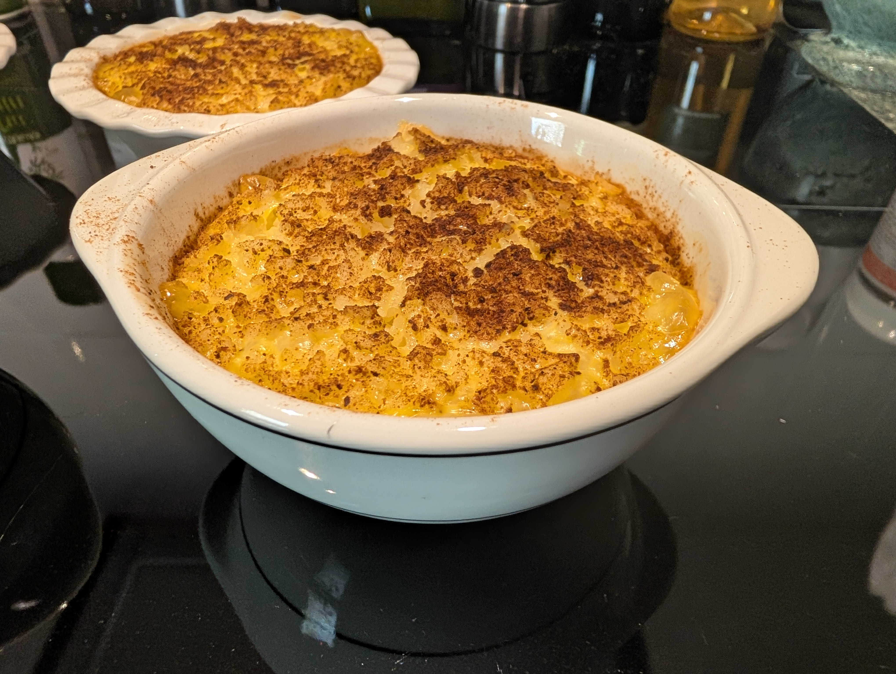

# Baked Rice Custard

## Ingredients

- 4 eggs
- ⅓ cup (75g) caster sugar
- ½ tsp vanilla extract
- 2 cups (500ml) milk
- 300ml cream
- [optional] ⅓ cup (50g) raisins
- 1 ½ cups cold, cooked, white medium-grain rice
- 1 tsp ground cinnamon

## Method

> 1. Preheat oven to 180°C (or 160°C for fan-forced). Grease a 1.5 litre (6-cup) baking dish.
> 1. Whisk eggs and sugar, and extract in medium bowl until combined. Whisk in milk and cream. Gently stir in raisins and rice.
> 1. Pour mixture into dish. Place dish inside large baking dish (nest first dish inside a larger one). Pour enough boiling water into the larger baking dish to come halfway up sides of dish. 
> 1. Bake for 30 minutes, whisking lightly with fork under skin occasionally. Sprinkle with cinnamon.
> 1. Bake a further 20 minutes. Serve warm or cold.

**Serves:** 6

     

<em>Created: 25th of June 2023 &middot; Last updated: 12th of October 2026</em>
