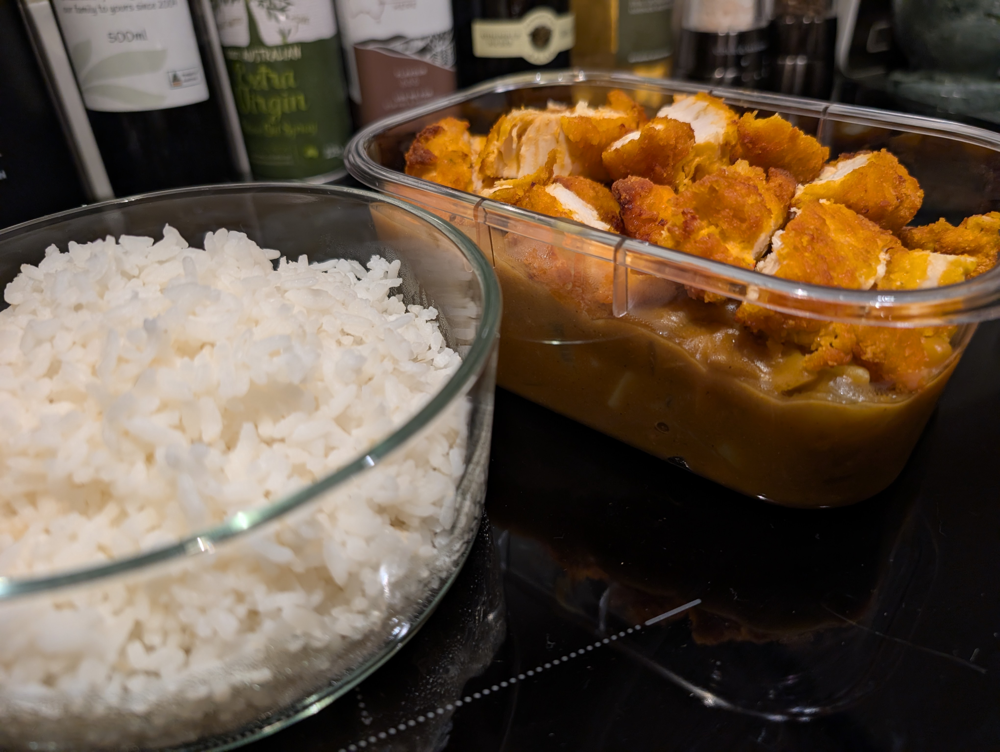

# Chicken Katsu Curry

## Ingredients

- 440g crumbed chicken schnitzels or tenders
- 1 tbs olive oil
- 1 large carrot, peeled, thickly sliced
- 2 medium potatoes, peeled, diced into 1½cm cubes
- 1 brown onion, coarsely chopped
- 1 clove garlic, crushed
- 92g S&B golden curry mild sauce mix
- 250g (1 cup) white rice

## Method

> 1. Preheat the oven at 180°C (160°C fan forced) for 5 minutes. Cook chicken for 25 minutes until cooked through.
> 1. Meanwhile, heat oil in a frying pan over medium heat. Add carrot, potato, onion and garlic, and saute for 5 minutes. Add 2 cups water. Bring to a boil, then cover with lid and simmer for until potato softens.
> 1. Remove from heat and crumble in curry mixture. Stir until nearly dissolved. Return to a low heat and cook for 2-3 minutes or until the sauce is smooth.
> 1. Cook rice according to your ricecooker instructions (or in a saucepan).
> 1. Slice chicken into 1½cm strips. Divide rice between serving bowls. Top with curry mixture and chicken.

## Tips

> - Some thinly sliced squash would go well as a garnish.
> - Reducing the quantity of vegetables would still make a good (and arguably more authentic) dish. Removing the potato entirely could work well. 
> - More garlic is always welcome in my house

**Serves:** 2-3

         

<em>Created: 28th of September 2026 &middot; Last updated: 12th of October 2026</em>
